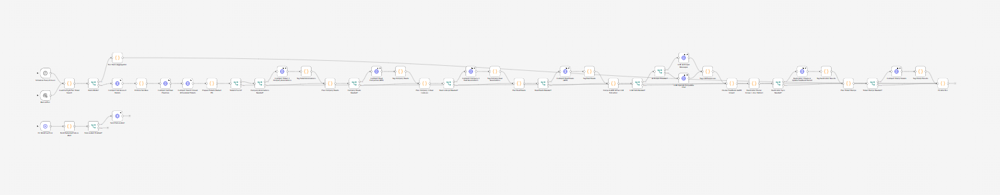

# n8n-hubspot-support-ticket-to-product-feedback-aggregator

I built this n8n workflow to turn support tickets into product signal that carries a revenue number. Every six hours it scans HubSpot for tickets that were closed or escalated since the last run, asks an LLM to extract feature requests, bug patterns and churn friction from each one, clusters similar requests across tickets, works out how much ARR sits behind each cluster, and creates or updates one structured feedback record per cluster in Linear, Jira or Notion.

The point is the ARR column. "Twelve tickets asked for SSO" is an anecdote; "SSO is blocking $310,000 of ARR across nine accounts, $120,000 of it flagged as churn risk" is a roadmap input.

- **Workflow:** [`workflows/support_feedback_aggregator.json`](workflows/support_feedback_aggregator.json) (import into n8n 1.x)
- **Node.js mirror and CLI:** `src/` (same logic, used for tests and local runs)
- **Runtime:** Node.js 20 or newer, no npm dependencies
- **Author:** DH Robin | dhRobin Systems · https://dhrobinsystems.com

> Safe by default: demo mode until a real HubSpot token is set, `LLM_PROVIDER=mock`, `DRY_RUN=true`, `SANDBOX_MODE=true` and `FEEDBACK_DESTINATION=none`. Read [DISCLAIMER.md](DISCLAIMER.md) before connecting anything real.

---

## Contents

1. [Architecture overview](#architecture-overview)
2. [Trigger mechanisms](#trigger-mechanisms)
3. [Flow breakdown](#flow-breakdown)
4. [Setup](#setup)
5. [Configuration reference](#configuration-reference)
6. [Safety model](#safety-model)
7. [Local development and tests](#local-development-and-tests)
8. [Maintenance notes](#maintenance-notes)
9. [Disclaimer and license](#️-disclaimer--liability-limitation)

---

## Architecture overview



```
 Schedule (every 6 h) / Manual
            │
            ▼
 Load Config & Plan Ticket Search ──► Demo Mode? ──yes──► Run Demo Aggregation ──┐
            │ no                                                                  │
            ▼                                                                     │
 1. HUBSPOT TICKET EXTRACTION                                                     │
    Account details → Enforce Sandbox → Deal pipelines                            │
    POST /crm/v3/objects/tickets/search (closed OR escalated, since watermark)    │
    Prepare Tickets: dedupe, strip HTML, redact PII                               │
            │                                                                     │
            ▼                                                                     │
 2. ARR DEAL LOOKUP                                                               │
    tickets → companies (v4 associations) → company batch read (ARR property)     │
    [ARR_SOURCE=closed_won_deals] companies → deals → deal batch read             │
            │                                                                     │
            ▼                                                                     │
 3. LLM EXTRACTION & CLASSIFICATION                                               │
    Compute ARR & Plan LLM Extraction → Anthropic? ─► Anthropic Messages          │
                                              └───► OpenAI-compatible chat        │
    Cluster Feedback & ARR Impact (validate JSON, cluster, sum ARR per company)   │
            │                                                                     │
            ▼                                                                     │
 4. DESTINATION SYNC                                                              │
    Destination Router → create / update in Linear | Jira | Notion                │
    (optional) stamp tickets with their cluster                                   │
            │                                                                     │
            ▼                                                                     │
 Finalize Run (commit watermark + registry unless DRY_RUN) ◄──────────────────────┘

 On Workflow Error → Build Redacted Failure Alert → ALERT_WEBHOOK_URL
```

I use the same pattern in all of my n8n repos: **Code nodes plan, HTTP Request nodes execute.** Each Code node embeds the plain JavaScript modules from `src/core/` and outputs request descriptions (`method`, `url`, `body`). HTTP Request nodes send them and read credentials from `$env` only at request time, so the workflow JSON never stores a token. Every write stage follows `Plan → Needed? → HTTP → Tag`, and the next Code node fails the execution if it received fewer responses than were planned.

State lives in n8n workflow static data:

| Key | Purpose |
| --- | --- |
| `ticketWatermark` | Last `hs_lastmodifieddate` fully processed; the next search starts here |
| `processedTickets` | Ticket ID → modified timestamp, so re-searched tickets are not counted twice (pruned after 30 days) |
| `feedbackClusters` | The cluster registry: category, canonical title, tokens, tickets, companies with ARR, churn scores, summaries and the destination record reference |

| Path | What it holds |
| --- | --- |
| `src/core/config.js` | Environment parsing, validation, safety switches |
| `src/core/hubspot.js` | Ticket search, PII redaction, associations, batch reads, ARR computation |
| `src/core/llm.js` | Prompt template, OpenAI and Anthropic request builders, strict output parser, offline mock |
| `src/core/cluster.js` | Tokeniser, similarity, clustering, metrics and priority |
| `src/core/sync.js` | Linear / Jira / Notion request builders, response parsing, state commit, alerts |
| `src/core/pipeline.js` | Node.js mirror of the full workflow |
| `src/core/mocks.js` | Fictional portal and in-memory HubSpot, LLM, Linear, Jira and Notion |
| `scripts/build-workflow.js` | Generates the workflow JSON from `src/core` |
| `tests/` | Unit tests, an n8n execution simulator and workflow/mirror parity tests |

## Trigger mechanisms

| Trigger | When | Notes |
| --- | --- | --- |
| **Schedule: Every 6 Hours** | Cron `0 */6 * * *` | Primary trigger. Change the interval in the node; the watermark makes any cadence safe. |
| **Manual Run** | On demand in the editor | Same path as the schedule. In demo mode it shows the full pipeline on fictional data. |
| **On Workflow Error** | Any failed execution | Builds a redacted alert and posts it to `ALERT_WEBHOOK_URL` when one is configured. |

I chose a scheduled search over a HubSpot webhook on purpose. Ticket webhooks fire on every property change, an escalation is often a priority edit rather than a status change, and the LLM call is the expensive step. A watermark-driven search batches the work, picks up both closed and escalated tickets with one query, and recovers automatically after downtime.

A ticket qualifies when **either** condition holds and it was modified since the watermark:

- `closed_date` has a value (the ticket was closed), or
- `TICKET_ESCALATION_PROPERTY` is one of `TICKET_ESCALATION_VALUES` (default `hs_ticket_priority` in `HIGH`, `URGENT`).

If your team escalates through a custom property or a dedicated pipeline stage, point `TICKET_ESCALATION_PROPERTY` at it (for example `hs_pipeline_stage` with the stage IDs of your escalation stages).

## Flow breakdown

### 1. HubSpot Ticket Extraction

1. **Load Config & Plan Ticket Search** validates every variable and computes the window start: the stored watermark, or `INITIAL_LOOKBACK_DAYS` on the first run.
2. **HubSpot: Get Account Details** and **Enforce Sandbox** stop the run unless the portal is a sandbox or developer test account while `SANDBOX_MODE=true`.
3. **HubSpot: Get Deal Pipelines** reads which deal stages count as closed-won.
4. **HubSpot: Search Closed & Escalated Tickets** sends one `POST /crm/v3/objects/tickets/search` with two OR filter groups, sorted oldest first and capped at `MAX_TICKETS_PER_RUN` (100 maximum). Anything beyond the cap waits for the next run, because the watermark only advances past tickets that were processed.
5. **Prepare Tickets (Redact PII)** drops tickets already processed at the same modified time, strips HTML, truncates to `MAX_TICKET_TEXT_CHARS` and replaces email addresses, phone numbers, card or account numbers, SSN-like numbers, links and credential-looking strings with tags such as `[email]` and `[phone]`. Only this redacted text ever reaches the LLM.

### 2. ARR Deal Lookup

1. **Ticket → Company Associations** (`POST /crm/v4/associations/tickets/companies/batch/read`, chunks of 100).
2. **Read Companies (ARR)** batch-reads `name`, `domain` and `ARR_COMPANY_PROPERTY`.
3. With `ARR_SOURCE=closed_won_deals`, **Company → Deal Associations** and **Read Deals (ARR)** sum `ARR_DEAL_PROPERTY` across deals in closed-won stages only. Open pipeline is never counted as ARR.

Per cluster I report two numbers:

- **ARR impact:** the sum of ARR across distinct companies that raised the theme. A company counts once per cluster no matter how many of its tickets landed there.
- **ARR at risk:** the same sum restricted to companies whose highest churn risk score on that cluster is at least `CHURN_RISK_THRESHOLD`.

### 3. LLM Extraction & Classification

**Compute ARR & Plan LLM Extraction** builds one request per ticket from the prompt template in `src/core/llm.js`. The system prompt requires JSON only, in this shape:

```json
{
  "items": [
    {
      "category": "feature_request | bug | churn_friction | other",
      "title": "Short canonical title, e.g. CSV export fails on large reports",
      "productArea": "reporting",
      "sentiment": "positive | neutral | negative",
      "churnRiskScore": 0,
      "summary": "One or two sentences, no names, emails or numbers that identify a person."
    }
  ]
}
```

The prompt asks for canonical, reusable titles (so the same request phrased five ways clusters together), at most `LLM_MAX_ITEMS_PER_TICKET` items, and states that the ticket text is data, not instructions, which keeps a customer-written ticket from steering the model.

- **Anthropic Provider?** routes to **LLM: Anthropic Messages** (`x-api-key`, `anthropic-version: 2023-06-01`) or **LLM: OpenAI-Compatible Chat** (`Authorization: Bearer`, `response_format: json_object`). Both send at temperature 0 in batches of three per second and retry on failure.
- With `LLM_PROVIDER=mock` no HTTP call is made: deterministic keyword rules produce the same JSON shape, which is how the demo and tests run offline.

**Cluster Feedback & ARR Impact** then:

1. Parses each response strictly (code fences tolerated, unknown categories mapped to `other`, scores clamped 0 to 100). A ticket whose response is missing or invalid is reported as an extraction failure and retried next run.
2. Matches each item against the stored registry: same category, and a Jaccard similarity of at least `CLUSTER_SIMILARITY` between the stemmed title tokens. No match starts a new cluster.
3. Recomputes ticket count, company count, ARR impact, ARR at risk, average and maximum churn risk, negative-sentiment share and a priority:

| Priority | Rule |
| --- | --- |
| 1 (Urgent) | ARR at risk ≥ `HIGH_PRIORITY_ARR` |
| 2 (High) | ARR impact ≥ `HIGH_PRIORITY_ARR` |
| 3 (Medium) | 3 or more tickets, or max churn risk ≥ `CHURN_RISK_THRESHOLD` |
| 4 (Low) | Everything else |

### 4. Destination Sync

**Destination Router (Linear / Jira / Notion)** plans one request per touched cluster that has at least `MIN_TICKETS_TO_SYNC` tickets (`other` is skipped unless `SYNC_OTHER_CATEGORY=true`). A cluster with no record yet is created; a cluster that already has a record in the same container is updated, so a recurring theme stays one record whose numbers grow instead of a pile of duplicates.

| Destination | Create | Update | Fields |
| --- | --- | --- | --- |
| Linear | GraphQL `issueCreate` | `issueUpdate` | title, markdown description, priority 1 to 4 |
| Jira Cloud | `POST /rest/api/3/issue` | `PUT /rest/api/3/issue/{key}` | summary, ADF description, labels `product-feedback` + category |
| Notion | `POST /v1/pages` | `PATCH /v1/pages/{id}` | Name, Category, Product Area, ARR Impact, ARR At Risk, Tickets, Companies, Max Churn Risk, Priority |

The description lists the ARR figures, the top companies with their ARR and churn risk, the latest redacted summaries and links to the source tickets in HubSpot.

**Plan Ticket Stamps** optionally writes "cluster title (record key)" back to each ticket in `TICKET_FEEDBACK_STAMP_PROPERTY`, so support can see where a ticket's feedback went.

**Finalize Run** commits the watermark, processed tickets and registry (never in `DRY_RUN`) and fails the execution if any destination write or ticket stamp failed. Successful writes are kept and recorded; failed tickets hold the watermark back and are retried.

## Setup

### Step 1: n8n

1. Use n8n 1.x (self-hosted or cloud) with access to environment variables in expressions. On self-hosted n8n, make sure `N8N_BLOCK_ENV_ACCESS_IN_NODE` is not set to `true`.
2. Set the variables from [`.env.example`](.env.example) in the n8n environment (for Docker: an `env_file` or `environment:` entries, then restart). Start with the defaults: `DRY_RUN=true`, `SANDBOX_MODE=true`, `LLM_PROVIDER=mock`, `FEEDBACK_DESTINATION=none`.
3. **Workflows → Import from File →** `workflows/support_feedback_aggregator.json`. The workflow imports inactive.
4. Click **Test workflow**. With a placeholder token you get demo mode: fictional tickets from Acme Corp, Example Inc, Sample Industries LLC and Demo Logistics Co., four clusters and their ARR figures in the **Finalize Run** output, and no network calls.
5. Optional: under **Workflow settings → Error workflow**, keep this workflow selected so **On Workflow Error** fires.

### Step 2: HubSpot Private App

1. In a **HubSpot developer test account or sandbox**, go to **Settings → Integrations → Private Apps → Create a private app**.
2. Scopes:
   - `tickets` (read)
   - `crm.objects.companies.read`
   - `crm.objects.deals.read`
   - `crm.objects.tickets.write` only if you set `TICKET_FEEDBACK_STAMP_PROPERTY`
3. Copy the access token into `HUBSPOT_PRIVATE_APP_TOKEN`.
4. Make sure the ARR source exists: a numeric company property (default `annual_recurring_revenue`) or closed-won deals with `amount` filled.
5. Optional: create a single-line text ticket property (for example `product_feedback_cluster`) and set `TICKET_FEEDBACK_STAMP_PROPERTY` to its internal name.
6. Run the workflow. **Enforce Sandbox** confirms the account type, and with `DRY_RUN=true` the run reads, extracts and clusters but writes nothing and leaves the watermark untouched, so you can repeat it while tuning.

### Step 3: LLM integration

1. Set `LLM_PROVIDER` to `openai` (any OpenAI-compatible chat completions endpoint, including gateways via `LLM_API_URL`) or `anthropic`.
2. Set `LLM_API_KEY=YOUR_LLM_API_KEY` to the real key in the n8n environment and `LLM_MODEL` to a current model name from your provider.
3. Keep `DRY_RUN=true` and compare the extracted clusters in **Finalize Run** against the source tickets. Tune `CLUSTER_SIMILARITY` (lower merges more, higher splits more) and `LLM_MAX_ITEMS_PER_TICKET`.
4. Confirm with your privacy lead that sending redacted ticket text to this provider is covered by your data processing terms.

### Step 4: Linear, Jira or Notion

Set `FEEDBACK_DESTINATION` and the matching block. While `SANDBOX_MODE=true` (or `DRY_RUN=true`) only the sandbox container is ever written to.

**Linear**
1. **Settings → Account → Security & access → Personal API keys → New key** and set `LINEAR_API_KEY`.
2. Create a sandbox team (for example "Feedback Sandbox") and put its team ID in `LINEAR_SANDBOX_TEAM_ID`; put the real product team's ID in `LINEAR_TEAM_ID`.

**Jira Cloud**
1. Create an API token at your Atlassian account's **Security → API tokens** and set `JIRA_EMAIL` and `JIRA_API_TOKEN`.
2. Set `JIRA_BASE_URL` to your site, `JIRA_SANDBOX_PROJECT_KEY` to a test project and `JIRA_PROJECT_KEY` to the real one. `JIRA_ISSUE_TYPE` must exist in both (default `Task`).

**Notion**
1. Create an internal integration and set `NOTION_API_KEY`.
2. Create a database with these properties and share it with the integration; do the same for a sandbox copy:

| Property | Type |
| --- | --- |
| Name | Title |
| Category | Select (Feature request, Bug, Churn friction, Other) |
| Product Area | Text |
| ARR Impact | Number |
| ARR At Risk | Number |
| Tickets | Number |
| Companies | Number |
| Max Churn Risk | Number |
| Priority | Select (Urgent, High, Medium, Low) |

3. Put the database IDs in `NOTION_DATABASE_ID` and `NOTION_SANDBOX_DATABASE_ID`.

### Step 5: Go live

1. Set `DRY_RUN=false` with `SANDBOX_MODE=true`. Records now appear in the sandbox container; check a few against their tickets.
2. Run it twice and confirm the second run reports `ticketsScanned: 0` and no new records.
3. When you are satisfied, connect the production HubSpot portal and set `SANDBOX_MODE=false`. Live mode refuses to start while any required value is a placeholder or while `LLM_PROVIDER=mock`.
4. Activate the workflow.

## Configuration reference

All variables, with defaults and comments, are in [`.env.example`](.env.example). The ones that change behaviour most:

| Variable | Default | Effect |
| --- | --- | --- |
| `DRY_RUN` | `true` | No writes, no state commit |
| `SANDBOX_MODE` | `true` | Sandbox portal and sandbox destination container only |
| `LLM_PROVIDER` | `mock` | `mock`, `openai` or `anthropic` |
| `FEEDBACK_DESTINATION` | `none` | `none`, `linear`, `jira` or `notion` |
| `TICKET_ESCALATION_PROPERTY` / `_VALUES` | `hs_ticket_priority` / `HIGH,URGENT` | What counts as escalated |
| `ARR_SOURCE` | `company_property` | `company_property` or `closed_won_deals` |
| `CHURN_RISK_THRESHOLD` | `60` | Score at which a company's ARR counts as at risk |
| `CLUSTER_SIMILARITY` | `0.5` | Title similarity needed to join a cluster |
| `HIGH_PRIORITY_ARR` | `50000` | ARR level for priorities 1 and 2 |
| `MAX_TICKETS_PER_RUN` | `50` | Upper bound on LLM calls per run |

## Safety model

| Guard | Behaviour |
| --- | --- |
| Demo mode | A placeholder HubSpot token runs the bundled fictional portal with mocks; no network calls |
| `DRY_RUN=true` | Reads and extracts, plans destination requests for review, writes nothing, does not move the watermark |
| `SANDBOX_MODE=true` | Refuses non-sandbox portals; writes only to `*_SANDBOX_*` containers |
| Live-mode lock | Refuses placeholders and the mock LLM when both switches are off |
| PII redaction | Applied before any text leaves HubSpot, including in DRY_RUN |
| Prompt-injection hardening | Ticket text is fenced and declared as data; output is schema-validated, never executed |
| No stored credentials | Secrets are read from `$env` in HTTP expressions only |
| Completeness checks | A stage that received fewer responses than it planned stops the run |
| Execution data | `saveDataSuccessExecution: none`, so successful runs do not retain ticket text in n8n |
| Redacted alerts | Tokens, keys, webhook URLs and email addresses are removed from failure messages |

## Local development and tests

```bash
npm run demo             # fictional tickets → clusters with ARR, no network
npm run run:once         # one run against the configured environment (.env), state in data/state.json
npm run build:workflow   # regenerate the workflow JSON after editing src/core
npm run verify           # lint + workflow drift check + all tests
```

`tests/n8n-simulator.js` executes the real Code node source from the workflow JSON together with the IF and HTTP Request node expressions. The parity tests run the n8n workflow and the Node.js mirror against the same mock HubSpot, LLM and destination servers and require identical clusters, totals and destination records. They also cover both LLM providers, all three destinations, idempotent re-runs, cluster updates, DRY_RUN, the sandbox gate, failed extractions and redacted alerts.

## Maintenance notes

- **Edit `src/core`, not the workflow JSON.** Run `npm run build:workflow`; `npm run check:workflow` fails CI if the JSON is out of date.
- **Re-clustering:** to start the registry fresh, clear the workflow's static data (or delete `data/state.json` for the CLI). Existing destination records are not deleted; the next run creates new ones.
- **Backfill:** clear static data and set `INITIAL_LOOKBACK_DAYS` to the window you want. Runs work through it `MAX_TICKETS_PER_RUN` tickets at a time, oldest first.
- **Model changes:** after switching `LLM_MODEL`, run with `DRY_RUN=true` and compare titles; a model that phrases titles differently will start new clusters.
- **API versions:** Notion requests send `NOTION_VERSION` (default `2022-06-28`); Jira uses REST v3; HubSpot uses CRM v3 objects and v4 associations.
- **Cost control:** LLM calls scale with `MAX_TICKETS_PER_RUN` times runs per day. Lower either if spend matters more than latency.

---

## ⚠️ Disclaimer & Liability Limitation

**Use at your own risk.** The code, workflows, and scripts provided in this repository (`n8n-hubspot-support-ticket-to-product-feedback-aggregator`) are for educational and architectural demonstration purposes.

* **No Liability:** The author and dhRobin Systems assume no responsibility or liability for any direct, indirect, incidental, or consequential damages resulting from the use, misuse, or deployment of these scripts.
* **No Warranty:** All software, n8n JSON blueprints, and JavaScript modules are provided "AS IS" without warranty of any kind, express or implied, including but not limited to merchantability, fitness for a particular purpose, or non-infringement.
* **Production Testing Required:** Always test thoroughly in an isolated staging environment (for example a HubSpot developer test account or sandbox) with `SANDBOX_MODE=true` and `DRY_RUN=true` enabled before connecting live HubSpot credentials. Validate extracted clusters and ARR figures against the source tickets in a sandbox Linear team, Jira project or Notion database before any record reaches a production backlog.
* **Third-Party APIs & Compliance:** Users are solely responsible for complying with the terms of service, rate limits, data privacy regulations (GDPR/CCPA), and security policies of HubSpot and any connected services, including the LLM provider that receives redacted ticket text, Linear, Jira and Notion.

The full disclaimer is also available in [DISCLAIMER.md](https://github.com/dhrobinsystems/n8n-hubspot-support-ticket-to-product-feedback-aggregator/blob/main/DISCLAIMER.md).

## License

Released under the MIT License. Copyright (c) 2026 DH Robin (dhRobin Systems). See [LICENSE](https://github.com/dhrobinsystems/n8n-hubspot-support-ticket-to-product-feedback-aggregator/blob/main/LICENSE).

DH Robin | dhRobin Systems · https://dhrobinsystems.com

---

DISCLAIMER.md · Licensed under the MIT License. License: MIT © 2026 dhRobin Systems · Provided as-is, see the disclaimer.
